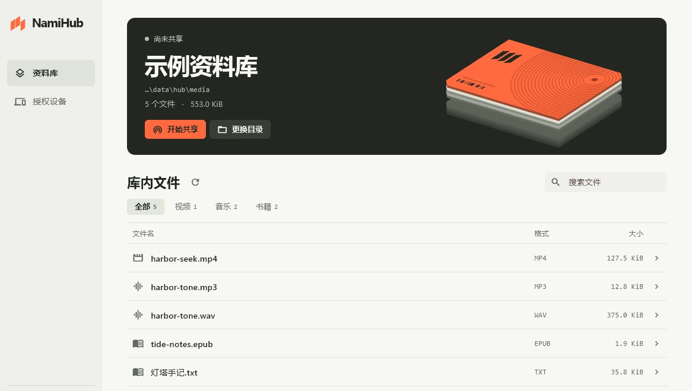

# NamiHub

在 Windows 上选一个文件夹，把书籍、视频和音乐共享给同一局域网里的设备。NamiRead 可以点书名在线阅读，NamiView 可以点片名直接播放。两端都用八位码配对，也可以单独下载一本书或一集视频。

[产品页](https://yo1128.github.io/NamiHub/) · [从源码构建](desktop/README.md) · [Dart SDK](packages/nami_hub_client/README.md) · [HTTP API v1](docs/api-v1.md)

## 开始共享

1. 在电脑上打开 `NamiHub.exe`。「更换目录」可选择要共享的文件夹。首页列出会对已授权设备开放的文件。
2. 点击「开始共享」。在同一局域网内打开 NamiRead 的「浏览 NamiHub 书库」或 NamiView 媒体库中的「NamiHub」，输入电脑上显示的八位码。每个应用单独配对。
3. 点书名或片名即可打开。需要离线使用时，在客户端的条目菜单中选择「下载到本机」。

共享时关闭窗口，主机会留在系统托盘。要结束共享，点击「停止共享」，或使用托盘菜单中的「退出并停止共享」。在「授权设备」中可以撤销单个应用的访问权限。

## 连接问题

- **找不到主机**　检查两端是否在可互访的 IPv4 局域网内。自动发现使用 UDP 47832，共享服务默认使用 HTTPS 8443。网络限制广播时，可在客户端展开「手动连接」，核对主机显示的地址和证书指纹。
- **配对码已使用或过期**　在电脑上生成新码。原有设备继续使用各自保存的授权。
- **文件有变动**　在资料库中刷新，客户端重新读取目录后即可看到新的内容版本。

## 项目结构

| 目录 | 用途 |
| --- | --- |
| [desktop](desktop/) | Flutter Windows 桌面端，包含资料库、文件搜索、配对窗口和系统托盘 |
| [lib](lib/) 和 [bin](bin/) | 文件索引、HTTPS 服务与命令行主机 |
| [packages/nami_hub_client](packages/nami_hub_client/) | Dart 客户端，支持配对、目录、按范围读取和断点下载 |
| [fixtures](fixtures/) | 可再生成的图书、音频和视频联调样本 |

开发者可使用[命令行主机](docs/interop.md)单独联调，或查阅[八位码配对协议](docs/lan-pairing.md)和[各客户端接入进展](docs/client-handoff.md)。
